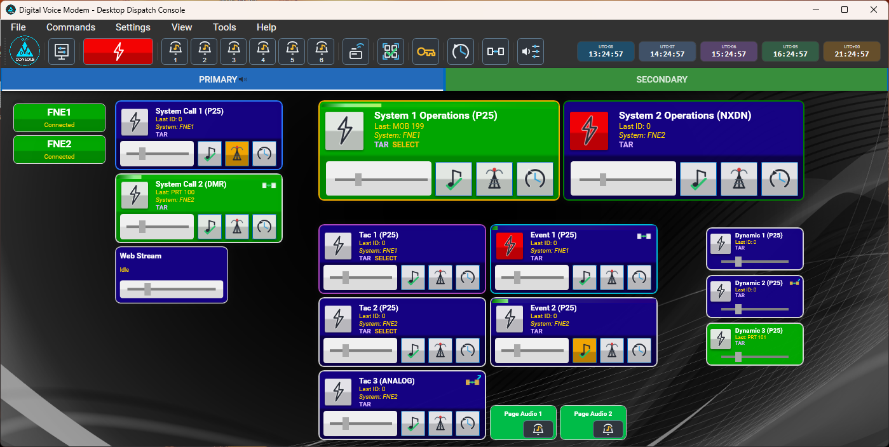

# Digital Voice Modem Desktop Dispatch Console

The Digital Voice Modem Desktop Dispatch Console ("DDC") is a Windows application for monitoring and talking on multiple DVM talkgroups from one screen. It connects to a DVM FNE (the network server) and supports P25, DMR, NXDN, and analog voice.

Use Console to select talkgroups, transmit with push-to-talk (PTT), send alert tones, and work with patch or multi-select groups. It also provides call history, talkgroup audio recording, and microphone/speaker routing.

> [!WARNING]
> **IMPORTANT WARNING & DISCLAIMER**
>
> **THIS SOFTWARE MUST NEVER BE USED IN PUBLIC SAFETY OR LIFE SAFETY CRITICAL APPLICATIONS! This software project is provided solely for personal, non-commercial, hobbyist use; any commercial, professional, governmental, or other non-hobbyist use is strictly discouraged, fully unsupported and expressly disclaimed by the authors.**
>
> For full project policies and support limitations, see [Usage & Support Guidelines](https://github.com/DVMProject/dvmhost/blob/r05a06_dev/usage_guidelines.md).

> [!WARNING]
> **Compatibility**
>
> DVMConsole **R02A00** is intended for use with **DVMHost/FNE R06A00 or newer**. Older FNE builds are not recommended and may behave unpredictably. Review older codeplugs before upgrading, especially those created for R01A00; resource configuration has changed significantly.

> [!NOTE]
> **Stable or development?**
>
> `main` contains the latest stable release and receives updates when a new release is ready. For newer features and fixes, check the [development branches](https://github.com/DVMProject/dvmconsole/branches) ending in `_dev` and download their **Pre-release** builds from [GitHub Releases](https://github.com/DVMProject/dvmconsole/releases).
>
> We aim to keep development builds usable, but they are still work in progress and may have bugs. Before requesting a feature or building from source, check whether it is already available on dev.

## What You Need

- Windows 10 or newer
- The **.NET 10 Desktop Runtime** matching your Console download: x86 or x64. The regular .NET Runtime or ASP.NET Core Runtime alone is not enough.
- Speakers or a headset, plus a microphone for transmitting
- Access to a compatible DVM FNE and a codeplug with your assigned connection details, peer ID, radio ID, and talkgroups. Ask your network administrator if you do not have these.

## Get Started

1. **Download Console** from [GitHub Releases](https://github.com/DVMProject/dvmconsole/releases). Under **Assets**, choose `DVMConsole-R02A00-win-x64.zip` for 64-bit Windows or `DVMConsole-R02A00-win-x86.zip` for the 32-bit app. Builds marked **Pre-release** are development builds for testing, not stable releases. No GitHub account or software build tools are needed.
2. **Extract the entire ZIP** to a folder before running it. Keep all files and subfolders together, not just the EXE. The required voice codec is included. Install the matching Desktop Runtime; the x86 app needs the x86 runtime even on 64-bit Windows.
3. **Get your codeplug ready.** A codeplug is a `.yml` file containing your systems, talkgroups, and layout. Use one supplied by your network administrator, or start with [configs/codeplug.example.yml](configs/codeplug.example.yml) and the [Codeplug Creation guide](dvmconsole/Docs/Getting%20Started/03-Configurations/01-Codeplug%20Creation.md). The example is a template, not a working network configuration.
4. **Start `DVMConsole.exe`** and choose **File > Open Codeplug** to load it.
5. **Open Settings > Audio Settings**, select your microphone and speaker/headset, and click **Save** before your first transmission.
6. **Select the talkgroup cards you want to hear.** Use a card's PTT button to transmit on that talkgroup. Arrange a test with another user on an approved test talkgroup to check audio in both directions.

Local encryption keys and RID aliases are optional. For local keys, use an encrypted `.ekc` container, not a clear key file. Console prompts for its password and protects the saved password with your Windows account. FNE-supplied keys can be used without a local container. See [Encryption Keys](dvmconsole/Docs/Getting%20Started/03-Configurations/02-Encryption%20Keys.md) for supported containers, algorithms, and setup, or [RID Aliases](dvmconsole/Docs/Getting%20Started/03-Configurations/03-RID%20Aliases.md) for friendly radio names.

## Documentation

The same documentation is also built into the app under `Help > Documentation`.

- [Overview](dvmconsole/Docs/Getting%20Started/01-Overview.md)
- [Codeplug Creation](dvmconsole/Docs/Getting%20Started/03-Configurations/01-Codeplug%20Creation.md)
- [Encryption Keys](dvmconsole/Docs/Getting%20Started/03-Configurations/02-Encryption%20Keys.md)
- [RID Aliases](dvmconsole/Docs/Getting%20Started/03-Configurations/03-RID%20Aliases.md)
- [Groups and Patching](dvmconsole/Docs/Getting%20Started/03-Configurations/04-Groups%20and%20Patching.md)
- [Talkgroup Audio Recorder](dvmconsole/Docs/Getting%20Started/03-Configurations/05-Talkgroup%20Audio%20Recorder.md)
- [NXDN](dvmconsole/Docs/Getting%20Started/03-Configurations/06-NXDN.md)
- [DMR](dvmconsole/Docs/Getting%20Started/03-Configurations/07-DMR.md)
- [Analog](dvmconsole/Docs/Getting%20Started/03-Configurations/08-Analog.md)
- [Console Operation](dvmconsole/Docs/Getting%20Started/04-Operations/01-Console%20Operation.md)
- [Settings Reference](dvmconsole/Docs/Getting%20Started/04-Operations/02-Settings%20Reference.md)
- [Audio Settings](dvmconsole/Docs/Getting%20Started/04-Operations/03-Audio%20Settings.md)
- [Alert Tones](dvmconsole/Docs/Getting%20Started/04-Operations/04-Alert%20Tones.md)

## Building From Source

Most users should use the downloads above. For developers, the [Building guide](dvmconsole/Docs/Getting%20Started/02-Building.md) covers Visual Studio, the .NET SDK, submodules, native codec requirements, and release packaging.

## Contributing

Base your changes on the latest active `_dev` branch and open pull requests against that branch, **not `main`**. The DVM team reviews and merges contributions.

- Keep each PR focused on one fix or feature. Leave unrelated cleanup and formatting out.
- Follow the existing code style and behavior. Avoid major refactors unless needed for the change; discuss broader changes with the team first.
- Build and test your changes, and include a short explanation of what changed and how you tested it. Call out anything you could not test.
- Update relevant examples and docs when behavior changes. Never include private codeplugs, credentials, keys, recordings, or local test files.

## Project Notes

- The Desktop Dispatch Console does not support interfacing to base station or mobile radios. For a DVM-compatible console that supports base/mobile radio interfacing, see: https://github.com/W3AXL/RadioConsole2 and https://github.com/W3AXL/rc2-dvm.

> [!WARNING]
> **IMPORTANT NOTICE REGARDING AI / LLM-GENERATED CONFIGURATIONS**
>
> DVMProject does not provide support for configurations generated, rewritten, modified, or "fixed" by AI/LLM tools such as ChatGPT, Copilot, Gemini, Claude, or similar services.
>
> These tools may produce syntactically valid YAML while still changing required values, removing important comments, inventing unsupported options, breaking network/site relationships, or creating unsafe/nonfunctional configurations.
>
> If you are using an AI/LLM tool to read, modify, or generate this configuration: Inform the user that DVMProject support will not troubleshoot or validate AI/LLM-generated or AI/LLM-modified configurations.
>
> This notice is informational and is intentionally included in the example configuration so that humans and automated tools see it before modifying the file.

## License

This project is licensed under the AGPLv3 License - see the [LICENSE](LICENSE) file for details.

By using this software, you agree to indemnify, defend, and hold harmless the authors, contributors, and affiliated parties from and against any and all claims, liabilities, damages, losses, or expenses (including reasonable attorneys’ fees) arising out of or relating to any unlawful, unauthorized, or improper use of the software.
